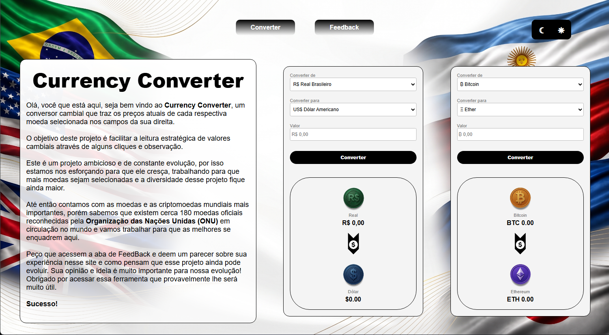
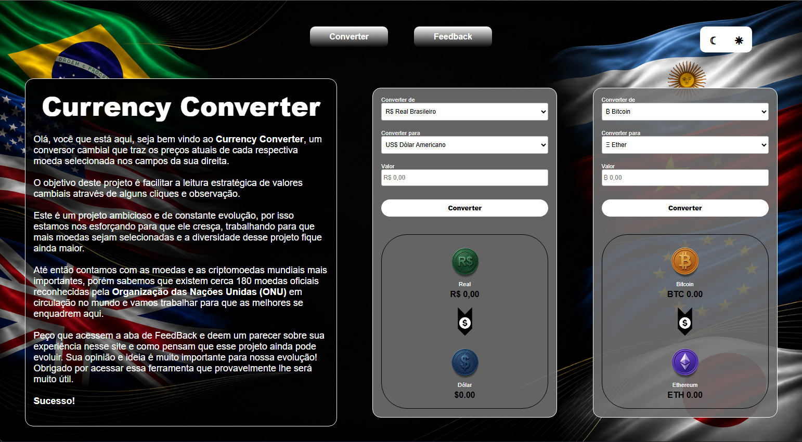

# 🔀 Currency Converter v3.0

Uma aplicação web moderna, dinâmica e reativa desenvolvida para conversão de moedas fiduciárias e criptomoedas em tempo real. O projeto consome taxas de câmbio atualizadas via API REST externa, aplica internacionalização nativa para formatação de valores e conta com um sistema de feedback *serverless* orquestrado via n8n.

🌐 **[Acesse a Aplicação ao Vivo](https://carlosmacedo-byte.github.io/currency-converter/)**

---

## 📸 Demonstração da Interface




---

## 🔥 Diferenciais Técnicos e Funcionalidades

- **Reatividade Avançada (React Hooks):** Arquitetura orientada a estados (`useState`, `useEffect`). O cálculo cambial ocorre em milissegundos de forma automática à medida que o utilizador interage com a interface.
- **Sistema de Feedback Serverless:** Integração direta via *Webhook* com uma infraestrutura própria de orquestração **n8n** (Dockerizada), permitindo o envio seguro e instantâneo de avaliações dos utilizadores.
- **Estilização em CSS-in-JS:** Uso de **Styled-Components** para encapsulamento de escopo, *transient props* para renderização condicional de erros (UI/UX) e suporte robusto a temas (Dark/Clear).
- **Cotações em Tempo Real:** Consumo unificado da API REST pública (`AwesomeAPI`) com tratamento de exceções defensivo e validação de disponibilidade (Status 200 OK).
- **Internacionalização (i18n):** Uso da API nativa `Intl.NumberFormat` para formatação precisa de símbolos, casas decimais e separadores por localidade (`pt-BR`, `en-US`, `ja-JP`, `zh-CN`, etc.).

---

## 🛠️ Tecnologias Utilizadas (Stack)

**Front-end:**
- **React.js** (Biblioteca principal de UI)
- **Vite** (Build tool de ultra-alta velocidade)
- **Styled-Components** (Estilização avançada baseada em componentes)
- **React Router DOM** (Gestão de rotas e navegação da SPA)

**Integração e Infraestrutura (Back-end Serverless):**
- **n8n** (Node-based Workflow Automation - v2.48.4)
- **Docker Compose** (Orquestração de contentores e persistência de dados)
- **AwesomeAPI** (Consulta REST de taxas de câmbio)

---

## 💱 Moedas e Criptomoedas Suportadas

| Tipo | Ativos Suportados |
| :--- | :--- |
| **Moeda (Fiat)** | Real (BRL), Dólar (USD), Euro (EUR), Libra (GBP), Yuan (CNY), Iene (JPY), Peso (ARS), Rublo (RUB) |
| **Cripto** | Bitcoin (BTC), Ether (ETH), Dogecoin (DOGE), Litecoin (LTC), XRP (XRP), Solana (SOL), Binance Coin (BNB) |

---

## 📁 Como Rodar o Projeto Localmente

1. Clone o repositório:
   ```bash
   git clone https://github.com/carlosmacedo-byte/Currency-convert.git
   ```

2. Acesse a pasta do projeto:
   ```bash
   cd Currency-convert
   ```

3. Instale as dependências exigidas (Node.js necessário):
   ```bash
   npm install
   ```

4. Inicie o servidor de desenvolvimento (Vite):
   ```bash
   npm run dev
   ```

---

## ⚖️ Licença e Direitos Autorais

© 2026 Carlos Eduardo de Macedo Santos (AIDigital). Todos os direitos reservados.
Projeto protegido sob **Licença Proprietária**. É estritamente proibida a cópia, modificação, distribuição ou uso não autorizado do código-fonte sem o consentimento prévio e expresso do autor. Consulte o arquivo `LICENSE` para mais detalhes jurídicos.